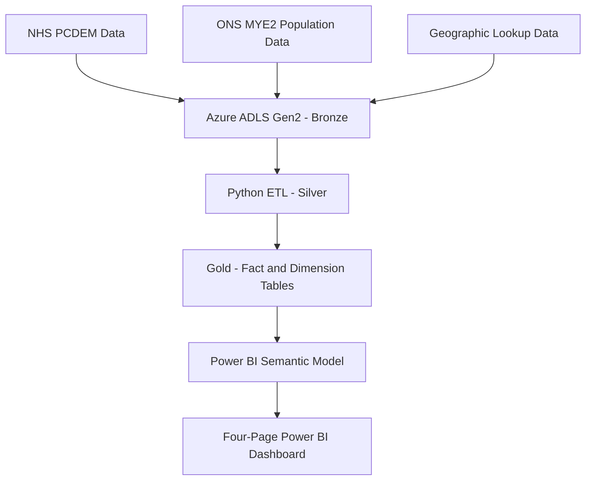

# UK Dementia Analytics — Azure Data Engineering & Power BI

## Project Overview

This project implements an end-to-end cloud data engineering and business intelligence solution to analyse dementia-related indicators and population demographics across England.

The solution integrates publicly available NHS dementia indicator data, Office for National Statistics (ONS) population estimates, and geographical reference datasets.

Using Microsoft Azure Data Lake Storage Gen2 and Python, the project implements a Medallion Architecture (Bronze, Silver and Gold) to ingest, clean, validate and transform data for analytical reporting.

The processed datasets are used in Power BI to create an interactive four-page dashboard covering dementia indicators, NHS regional comparisons, age and gender distributions, and local authority population demographics.

## Technologies Used

- **Cloud Platform:** Microsoft Azure, Azure Data Lake Storage Gen2
- **Programming:** Python, Pandas
- **Data Engineering:** ETL, Medallion Architecture, CSV, Parquet
- **Data Modelling:** Fact Tables, Dimension Tables, Star Schema Design
- **Business Intelligence:** Microsoft Power BI, DAX, Power Query
- **Version Control:** Git and GitHub

## Data Sources

**1. NHS Primary Care Dementia Data (PCDEM)**

- 24,804 records
- 106 NHS Sub-ICBs
- 13 reporting months, October 2024–October 2025
- Dementia indicators categorised by age and sex

**2. ONS Population Estimates (MYE2)**

- Population estimates by local authority
- Total population and age-specific population counts
- Used to analyse population demographics and residents aged 65+

**3. Geographical Lookup Dataset**

- NHS Sub-ICB, ICB and local authority reference information
- Supports geographical standardisation and analysis

## Data Architecture

The project follows a three-layer Medallion Architecture.

flowchart TD




### Bronze Layer — Raw Data Ingestion

- Ingested source CSV files into Azure Data Lake Storage Gen2.
- Preserved the original data structure.
- Organised source datasets into dedicated storage paths.

### Silver Layer — Data Cleaning and Validation

- Standardised data types and column structures.
- Checked missing values and duplicate records.
- Validated geographical identifiers and reporting dates.
- Produced cleaned datasets in Parquet format.

### Gold Layer — Analytical Data Modelling

- Prepared structured fact and dimension tables.
- Implemented a dimensional model for analytical reporting.
- Established relationships between fact and dimension tables in Power BI.
- Developed DAX measures for KPIs and interactive analysis.

## Power BI Dashboard

The dashboard contains four analytical pages.

### Dashboard Preview

#### Dashboard Screenshot 1


#### Dashboard Screenshot 2


#### Dashboard Screenshot 3


#### Dashboard Screenshot 4


### Page 1 — Dementia Overview

- Selected-period dementia indicator
- NHS Sub-ICB coverage
- Dementia indicators by age group
- Monthly reporting trends
- Top 10 NHS ICBs

### Page 2 — Regional Analysis

- NHS ICB comparisons
- Regional indicator rankings
- Monthly trends by ICB
- Interactive year and geographical filters

### Page 3 — Age & Gender Analysis

- Male and female dementia indicators
- Age-group distributions
- Monthly trends by sex
- Interactive demographic comparisons
### Page 4 — Population Analysis

- Total population
- Population aged 65+
- Percentage of population aged 65+
- Top 10 local authorities by population
- Local authority demographic comparisons


## Technical Challenges and Solutions

### 1. Azure Storage Permission Errors

**Challenge:** Encountered `AuthorizationPermissionMismatch`
errors when uploading processed datasets to Azure Data Lake
Storage Gen2.

**Solution:** Reviewed Azure storage access permissions,
updated the required access configuration and successfully
uploaded datasets to the Silver layer.

**Skills demonstrated:** Azure RBAC, cloud authentication,
troubleshooting.

### 2. Data Quality and Validation

**Challenge:** Needed to ensure NHS dementia indicators and
ONS population data were consistent before transformation.

**Solution:** Implemented Python validation checks for
missing values, duplicates, reporting dates and population
totals.

**Validation results:**
- NHS PCDEM: 24,804 records
- Duplicate PCDEM records: 0
- Missing PCDEM values: 0
- ONS MYE2: 404 source records
- Population total mismatches: 0

**Skills demonstrated:** Python, Pandas, data validation.

### 3. Geographic Data Integration

**Challenge:** NHS Sub-ICB and local authority datasets use
different geographic boundaries and identifiers.

**Solution:** Inspected geographic lookup data, validated
identifiers and maintained separate geographic dimensions
where a reliable direct relationship was unavailable.

**Skills demonstrated:** Data modelling, geographic data
integration, analytical accuracy.

### 4. Power BI Filtering and Ranking

**Challenge:** Regional Top 10 charts initially displayed
unexpected rankings because of sorting and slicer settings.

**Solution:** Corrected the chart sorting to use the
Selected Period Dementia Indicator measure and reviewed
visual-level Top N filters.

**Skills demonstrated:** Power BI, DAX, report validation.

### 5. Time-Responsive DAX Measures

**Challenge:** The initial latest-month calculation did not
respond correctly to the selected reporting year.

**Solution:** Developed a selected-period measure using
MAX(DimDate[Reporting_Date]) so KPIs could respond to
reporting-period filters.

**Skills demonstrated:** DAX, filter context, semantic
modelling.


Project Purpose

This project demonstrates practical experience in cloud data engineering, data transformation, dimensional modelling, analytical reporting and dashboard development using Azure, Python and Power BI.

## Gold Layer — Dimensional Data Model

The Gold layer contains six analytical tables designed
for reporting in Power BI.

### Fact Tables

| Table | Description |
|---|---|
| FactDementia | Dementia indicator values by reporting period, age, sex and NHS Sub-ICB |
| FactPopulation | Total population and population aged 65+ by local authority |

### Dimension Tables

| Table | Description |
|---|---|
| DimDate | Reporting dates, months and years |
| DimDemographic | Age groups and sex |
| DimSubICB | NHS ICB and Sub-ICB information |
| DimLocalAuthority | English local authority information |

### Power BI Relationships

- DimDate → FactDementia
- DimDemographic → FactDementia
- DimSubICB → FactDementia
- DimLocalAuthority → FactPopulation

The model uses two fact tables with separate geographical
dimensions.

Dementia indicators are reported by NHS Sub-ICB, while
population estimates are analysed by local authority.

A direct prevalence calculation is not implemented because
the geographic boundaries and denominators require further
validation.

## Power BI — DAX Measures

The Power BI semantic model includes DAX measures
for time-based reporting, demographic comparisons,
regional analysis and population statistics.

### Selected Period Dementia Indicator

```dax
Selected Period Dementia Indicator =
VAR LatestSelectedDate =
    MAX(DimDate[Reporting_Date])
RETURN
CALCULATE(
    SUM(FactDementia[Measure_Value]),
    DimDemographic[Sex] = "ALL",
    DimDate[Reporting_Date] = LatestSelectedDate
)
```

This measure calculates the dementia indicator for
the latest reporting month within the selected period.

### Monthly Dementia Indicator

```dax
Monthly Dementia Indicator =
CALCULATE(
    SUM(FactDementia[Measure_Value]),
    DimDemographic[Sex] = "ALL"
)
```

This measure supports monthly trend analysis.

### Total Population

```dax
Total Population =
SUM(FactPopulation[Total_Population])
```

### Population Aged 65+

```dax
Population Aged 65+ =
SUM(FactPopulation[Population_65_Plus])
```

### Population Aged 65+ Percentage

```dax
Population Aged 65+ % =
DIVIDE(
    [Population Aged 65+],
    [Total Population],
    0
)
```

These measures support interactive Power BI dashboards
with reporting-period and geographical filtering.

